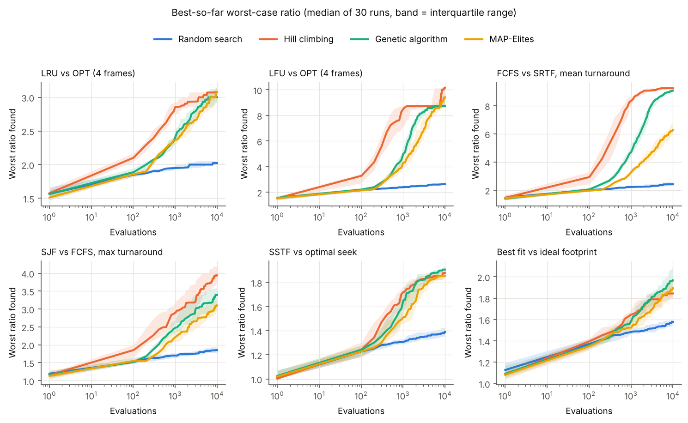
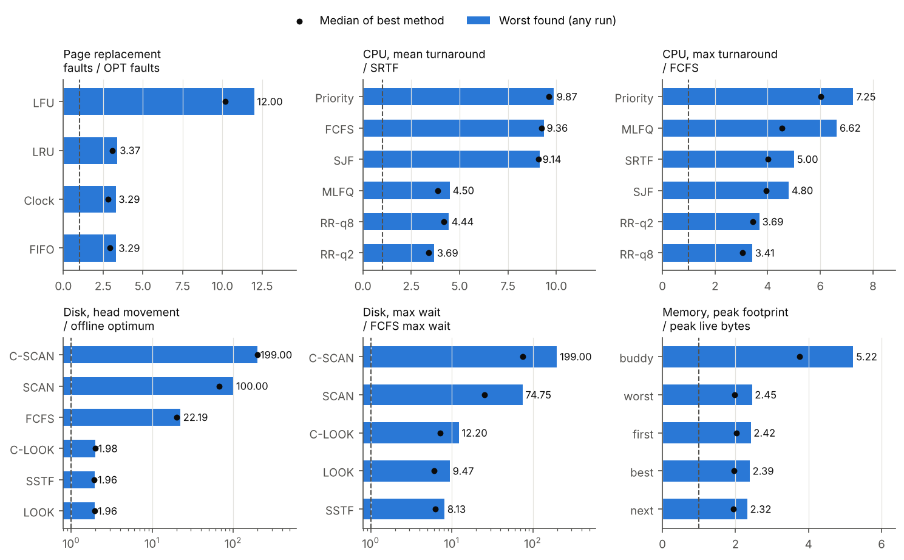
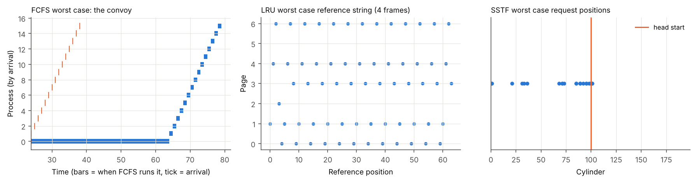
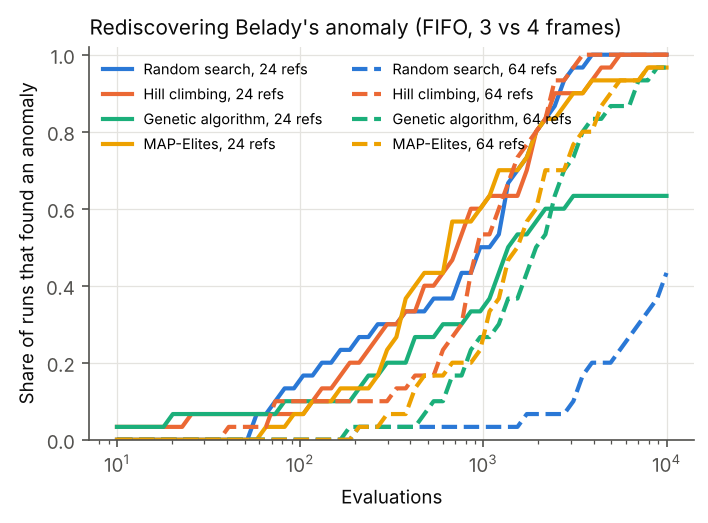
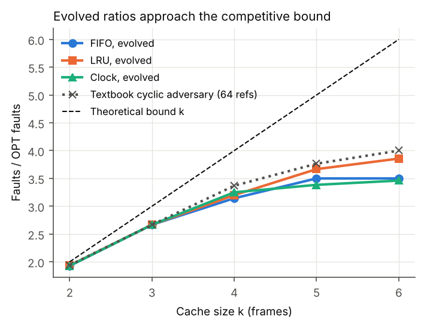
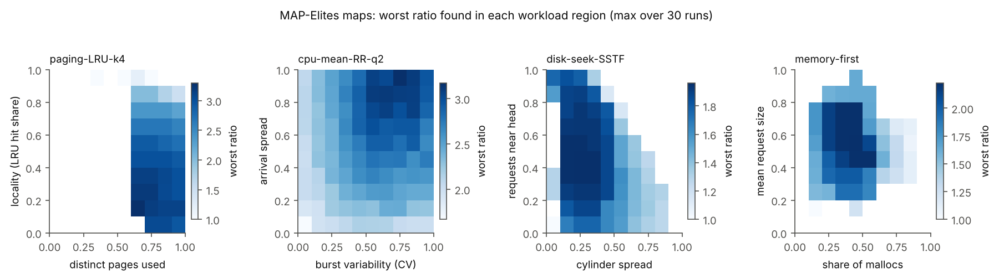
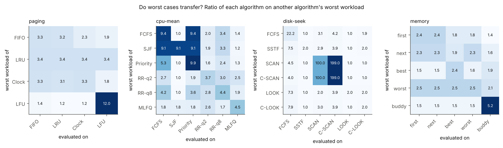

# 1. Introduction

An operating system takes the same small decisions millions of times a second: which ready process runs next, which page leaves memory, which disk request the arm serves next, and where a new heap block goes. Textbooks describe each policy with a rule, a worked example, and sometimes a theorem. For instance, LRU paging is at most k times worse than the optimal policy on a k-frame cache [Sleator and Tarjan 1985], SRTF minimises mean turnaround time [Schrage 1968], and FIFO paging can fault more when given more memory [Belady et al. 1969].

These facts leave three practical questions open:

1. How bad does a policy get on inputs of the size a student, tester or designer actually works with, rather than in the limit?
2. What do the bad inputs look like, and are they the ones the textbooks show?
3. Which policies degrade gracefully, and which have cliffs?

Momus answers them empirically. It treats each policy as an opponent and evolves workloads that maximise the policy's cost relative to an optimal or reference policy on the same workload. The name refers to the Greek god of criticism, whose role was to find fault.

**Contributions.**

- A single framework with simulators for four OS domains (22 policies), a shared integer-matrix genome, and fitness defined as the empirical competitive ratio against a provably optimal or clearly stated reference.
- A study of 4,380 search runs (32 attack settings, 4 search methods, 30 seeds, plus two Belady settings and a cache-size sweep) with standard statistics for randomised algorithms.
- Evidence that the search rediscovers known pathologies without hints, approaches known bounds, and finds new quantitative contrasts: LOOK versus SCAN, buddy versus fit allocators, and preemptive versus non-preemptive schedulers.
- A released set of worst-case workloads, all code, and a beginner's guide (`docs/GUIDE.md`).

# 2. Background

**Competitive ratio.** An online policy A decides without seeing the future. Its competitive ratio is the worst case, over inputs w, of cost_A(w) / cost_OPT(w), where OPT is the best offline decision sequence. Sleator and Tarjan [1985] showed that LRU and FIFO are k-competitive for paging and that no deterministic online policy does better.

**Optimal references.** For paging, Belady's MIN (OPT) evicts the page used furthest in the future and is optimal [Belady 1966]. For a single CPU with release times, SRTF minimises total (and therefore mean) turnaround time [Schrage 1968], while FCFS minimises the maximum turnaround (flow) time. For a batch of disk requests on a line, the optimal schedule sweeps to the nearer extreme first and then to the other, with cost min(|h - lo|, |h - hi|) + (hi - lo). For dynamic storage allocation, no allocator can use less memory than the peak volume of live data, and Robson [1974] showed that every allocator has inputs needing a logarithmic factor more.

**Belady's anomaly.** FIFO paging can produce more faults with more frames. The classic string 1 2 3 4 1 2 5 1 2 3 4 5 gives 9 faults with 3 frames and 10 with 4 [Belady et al. 1969]. Belady et al. conjectured that the ratio of faults is at most 2, and Fornai and Iványi [2010] later showed that it is unbounded.

**Evolutionary and quality-diversity search.** Genetic algorithms [Holland 1975] evolve a population by selection, crossover and mutation. MAP-Elites [Mouret and Clune 2015] keeps the best solution in each cell of a grid of behaviour descriptors, so the output shows how quality varies across kinds of solution.

# 3. The Momus framework

## 3.1 Workloads as genomes

Every workload is an integer matrix with one row per event and a fixed range for each column (Table 1). The ranges are the validity envelope: every genome decodes to a legal workload, so the search cannot win with impossible inputs.

| Domain | Row | Rows | Column ranges |
| --- | --- | --- | --- |
| Paging | page number | 64 | 0 to 7 (8 pages); k = 4 frames unless stated |
| CPU | (arrival, burst, priority) | 16 | arrival 0 to 100, burst 1 to 40, priority 0 to 4 |
| Disk | (arrival, cylinder) | 24 | arrival 0 to 400, cylinder 0 to 199; head starts at 100 moving up |
| Memory | (malloc or free, size, victim) | 120 | size 1 to 64; a free releases live block number victim mod (live count), and is a no-op when nothing is live |

Table: Table 1. Genome encoding per domain.

## 3.2 Policies and fitness

Fitness is always "larger is worse for the policy under attack".

| Setting | Policies attacked | Reference | Fitness |
| --- | --- | --- | --- |
| Paging | FIFO, LRU, Clock, LFU | OPT (MIN) | faults / OPT faults |
| CPU, mean | FCFS, SJF, Priority, RR q=2, RR q=8, MLFQ (quanta 2, 4, 8, no boost) | SRTF (optimal) | mean turnaround ratio |
| CPU, max | SJF, Priority, SRTF, RR q=2, RR q=8, MLFQ | FCFS (optimal for max) | max turnaround ratio |
| Disk, seek | FCFS, SSTF, SCAN, C-SCAN, LOOK, C-LOOK (all requests at time 0) | offline optimum | (movement + 1) / (optimum + 1) |
| Disk, wait | SSTF, SCAN, C-SCAN, LOOK, C-LOOK (requests arrive over time) | FCFS (peer) | (max wait + 1) / (FCFS max wait + 1) |
| Memory | first, next, best, worst fit; binary buddy | ideal allocator (peak live bytes) | peak footprint / peak live bytes |
| Belady | FIFO with k = 3 vs k + 1 = 4 frames | FIFO, k frames | extra faults with more memory |

Table: Table 2. Attack settings. The +1 in the disk ratios keeps them finite when the reference cost is zero.

The simulators use integer time, a single CPU and disk arm, free context switches, and zero rotational and transfer time. Their correctness is checked by 11 tests: textbook examples from Silberschatz et al. for every domain, brute-force optimality checks for OPT, SRTF and the disk optimum on small random inputs, and no-overlap invariants for every allocator.

## 3.3 Search strategies

All methods get the same budget of 10,000 fitness evaluations per run.

- **Random search** samples fresh workloads uniformly within the envelope.
- **Hill climbing** is a (1+1) evolutionary algorithm: it mutates the incumbent, keeps the child if it is at least as bad, and restarts after 500 evaluations without strict improvement.
- **Genetic algorithm (GA):** a population of 50, tournament selection of size 3, two-point row crossover with probability 0.7, and the 2 worst-case workloads kept each generation.
- **MAP-Elites:** a 10 x 10 grid over two workload descriptors per domain (for example, distinct pages and locality for paging), 200 random initial workloads, then mutation (with crossover between elites at probability 0.3) of a uniformly chosen elite.

Mutation applies 1 + Poisson(0.5) edits drawn from six operators: reset a cell, nudge a cell by up to 10 percent of its range, swap two rows, copy a block of rows elsewhere, reverse a block, and insert or delete a row. Block copy matters most: it creates the loops and repeated bursts that break many policies.

## 3.4 Experimental protocol

Each of the 32 main settings is attacked by all 4 methods with 30 seeds (3,840 runs). Belady's anomaly is studied at two string lengths (240 runs), and the bound sweep covers k = 2 to 6 for FIFO, LRU and Clock with hill climbing and the GA (300 runs). We report medians, 95 percent bootstrap confidence intervals, two-sided Mann-Whitney U tests and the Vargha-Delaney A12 effect size [Vargha and Delaney 2000], following Arcuri and Briand [2011]. The whole study took 1.8 CPU-hours (27 minutes on 4 cores).

# 4. Results

## 4.1 Does evolution beat random search?

Yes, in every setting. Hill climbing, the GA and MAP-Elites each beat random search with p < 0.05 in all 32 settings, with A12 at least 0.991 (median 1.0). Random search is never the best method. The gap is large where the bad inputs are structured: random workloads give FCFS a median mean-turnaround ratio of 2.4 against 9.2 for hill climbing; random SJF scores 1.4 against 9.1, random C-SCAN 2.5 against 199, and random LFU 2.6 against 10.2.

The strongest single method is the restarting **hill climber**, best by median in 21 of 32 settings, against 9 for the GA and 2 for MAP-Elites. Comparing hill climbing directly with the GA (median A12 0.68), A12 is above 0.56 (hill climber better) in 21 settings and below 0.44 (GA better) in 5. The GA is better on memory allocation and on Round Robin and MLFQ mean turnaround, where useful structure is spread over many rows and crossover can recombine it. MAP-Elites finds lower peaks but fills 57 percent of its grid on average, giving the map of Section 4.6. Figure 1 shows convergence for six representative settings.

## 4.2 How fragile is each policy?

Figure 2 and Table 3 rank every policy by the worst ratio any run found.

| Setting | Most robust to least robust (worst ratio found) |
| --- | --- |
| Paging vs OPT | FIFO 3.29, Clock 3.29, LRU 3.37, **LFU 12.0** |
| CPU mean turnaround vs SRTF | RR q=2 3.69, RR q=8 4.44, MLFQ 4.50, SJF 9.14, FCFS 9.36, **Priority 9.87** |
| CPU max turnaround vs FCFS | RR q=8 3.41, RR q=2 3.69, SJF 4.80, SRTF 5.00, MLFQ 6.63, **Priority 7.25** |
| Disk head movement vs optimum | LOOK 1.96, SSTF 1.96, C-LOOK 1.98, FCFS 22.2, SCAN 100, **C-SCAN 199** |
| Disk max wait vs FCFS | SSTF 8.13, LOOK 9.47, C-LOOK 12.2, SCAN 74.8, **C-SCAN 199** |
| Memory footprint vs live bytes | next 2.32, best 2.39, first 2.42, worst 2.45, **buddy 5.22** |

Table: Table 3. Robustness ranking (full table with confidence intervals in `results/main_results.csv` and `results/robustness_ranking.csv`).

Four contrasts stand out.

**Round Robin trades average for guarantees.** On mean turnaround the time-sliced policies stay within 3.7 to 4.5 times SRTF, while every non-preemptive policy (FCFS, SJF, Priority) can be pushed past 9. On the maximum turnaround the order flips for SJF and SRTF, which starve long jobs (4.8 and 5.0 times FCFS).

**LOOK is safe, SCAN is not.** LOOK and C-LOOK never exceeded twice the optimal movement. For LOOK this is a theorem: with the head inside [lo, hi] it travels at most (hi - h) + (hi - lo) <= 2(hi - lo) <= 2 OPT, and outside that range it is optimal. SCAN and C-SCAN have no such bound: the search finds that a request one cylinder behind the head forces SCAN to travel to the edge and back (199 cylinders against 1) and C-SCAN to sweep the whole disk twice (397 against 1).

**LFU is in a different class from the recency policies.** LRU, FIFO and Clock all stop at about 3.3, close to the 3.37 that the textbook cyclic adversary achieves at this string length, while LFU reaches 12 (60 faults against 5).

**Buddy allocation pays twice.** All four fit policies cluster at 2.3 to 2.5 times the live data, while buddy reaches 5.2 because rounding to powers of two (internal fragmentation) and buddy-pair splitting (external fragmentation) compound.

## 4.3 Rediscovering known pathologies

Figure 3 shows three evolved worst cases.

- **Convoy effect (FCFS, SJF, Priority, mean).** The worst FCFS workload has one long job (73 percent of all CPU time) arriving just before 15 short jobs. Arrivals compress to 16 percent of the window and the burst coefficient of variation rises from 0.55 for random workloads to 2.75. SJF's worst case is the same shape: being non-preemptive, it cannot interrupt a long job that arrived alone.
- **Cyclic adversary (LRU).** The evolved LRU string cycles through exactly k + 1 = 5 pages in fixed order, the textbook construction, so LRU faults on almost every reference.
- **Stale frequency (LFU).** The evolved string first touches a few pages twice to give them high counts, then alternates between two new pages, which keep evicting each other because each enters with a count of 1. LFU faults 60 times out of 64 references.
- **Starvation (SJF, SRTF, Priority, max).** The worst cases spread arrivals across the whole window (arrival spread 0.98) so that a steady stream of short or high-priority jobs keeps one job waiting.
- **Edge travel (SCAN, C-SCAN).** All requests sit within a cylinder of the head, behind it.

## 4.4 Belady's anomaly

Belady's anomaly is rare among random strings, yet the search finds it reliably (Table 4, Figure 4). With 64 references, random search finds an anomalous string in 43 percent of runs while hill climbing finds one in 100 percent, after a median of 940 evaluations. The largest anomaly found is a 64-reference string that costs FIFO 25 faults with 3 frames and **37 faults with 4 frames** (ratio 1.48). The best 24-reference string, 4 5 0 2 4 5 1 4 3 5 2 1 4 4 3 5 2 0 4 3 0 5 2 0, gives 14 faults with 3 frames and **20 with 4** (ratio 1.43), against 9 versus 10 for the textbook string.

| Length, pages | Method | Runs with an anomaly | Median evaluations to first | Most extra faults (ratio) |
| --- | --- | --- | --- | --- |
| 24, 6 | Random | 100% | 1,060 | 2 (1.20) |
| 24, 6 | Hill climbing | 100% | 680 | 6 (1.43) |
| 24, 6 | GA | 63% | 826 | 6 (1.43) |
| 24, 6 | MAP-Elites | 97% | 652 | 4 (1.31) |
| 64, 8 | Random | 43% | 5,562 | 2 (1.05) |
| 64, 8 | Hill climbing | 100% | 940 | 12 (1.48) |
| 64, 8 | GA | 97% | 1,860 | 12 (1.41) |
| 64, 8 | MAP-Elites | 97% | 1,435 | 10 (1.53) |

Table: Table 4. Belady's anomaly search (FIFO with 3 versus 4 frames, 30 runs each).

A negative result is worth stating: in an exploratory run we did not find an anomaly with 12-reference strings over 5 pages in 10,000 evaluations, even though the classic string lives in that space. Anomalies are so sparse at that length that the zero-fitness plateau gives the search nothing to climb. Longer strings contain many more anomalous neighbours.

## 4.5 How close do evolved ratios get to the bound?

For each cache size k we compare the worst evolved ratio with the textbook cyclic adversary at the same length (64 references) and with the asymptotic bound k (Figure 5).

For k = 2 and 3 the search matches the cyclic adversary exactly for all three policies. For larger caches it falls short: at k = 6 it reaches 3.86 for LRU (96 percent of the adversary's 4.0), 3.50 for FIFO and 3.46 for Clock. The cyclic adversary itself stays below k because 64 references are too few to amortise OPT's cold faults. The gap widens with k because the adversary must cycle through exactly k + 1 pages, a needle the mutation operators find less often as the page alphabet grows. In the main study (30 runs, 4 methods) the search did match the adversary's 3.37 for LRU at k = 4.

## 4.6 Where are the worst cases? Mapping and explanation

Figure 6 shows the MAP-Elites archives merged over 30 runs. For LRU, severity falls steadily as locality rises (Spearman rho = -0.92 between the locality bin and the cell's worst ratio). For FIFO and Clock rho is -0.82. LFU is the exception (rho = +0.64): its worst cases need high locality to build the stale counts it then gets trapped by. For the non-preemptive schedulers, severity tracks burst variability almost perfectly (rho 0.98 to 1.0), whereas for MLFQ and the max-turnaround settings it tracks arrival spread (rho 0.65 to 0.90). For SCAN and C-SCAN, severity falls sharply as requests spread out (rho -0.97).

## 4.7 Do worst cases transfer?

We evaluated each policy's single worst workload on every other policy in the same setting (Figure 7). Transfer follows mechanism. The LRU cyclic string is equally bad for FIFO, Clock and LFU (3.4 for each), but the LFU trap is mild for the others (1.2 to 1.4). The FCFS convoy is just as bad for Priority (9.4) but harmless for SJF (1.0), which simply runs the short jobs first. The SCAN and C-SCAN edge cases hurt each other and FCFS, but leave SSTF, LOOK and C-LOOK at the optimum (ratio 1.0). The buddy worst case does not transfer to the fit allocators (1.5), and their worst cases transfer to each other (1.5 to 2.5).

# 5. Discussion

**What the study suggests for practice.** Where a policy has a theoretical bound, the search confirms it is the real worst case at realistic sizes (LRU, FIFO and Clock near the cyclic adversary; LOOK within 2). Where there is no bound, the search finds the cliffs: LFU, SCAN and C-SCAN, non-preemptive scheduling for mean response, and buddy allocation for memory footprint. A designer choosing a default could rank candidates by these numbers alongside average-case benchmarks.

**Why hill climbing wins.** Most worst cases here are one repeated motif (a cycle, a convoy, a cluster). A single mutating incumbent with restarts reaches and polishes that motif quickly, while a GA spends evaluations keeping a diverse population. The GA wins where the bad workload combines many independent parts, as in heap fragmentation. MAP-Elites is the right tool for explanation rather than for the single worst score.

**Threats to validity.**

- *Simplified simulators.* There are no context-switch, rotational or allocator-metadata costs, and time is integer. Results describe policies, not kernels.
- *Small workloads.* Sizes were chosen to keep 4,380 runs cheap. Section 4.5 shows ratios still grow with length, so the absolute numbers are lower bounds on the policies' true worst cases.
- *Search is not proof.* The search shows that a bad case exists; it cannot show that nothing worse exists.
- *Peer references.* The disk-wait setting is relative to FCFS, which is not optimal for maximum wait, so those ratios compare policies rather than measure distance from optimal.
- *Degenerate ratios.* With the +1 smoothing, SCAN and C-SCAN reach their ceiling of about the disk size once the optimum is 1 cylinder. This is a true property of the policies, but the exact numbers depend on disk size.

# 6. Conclusion

Momus turns worst-case analysis of OS policies into a search problem with a clear objective: the empirical competitive ratio against an optimal reference. In a single framework it rediscovered the convoy effect, the cyclic LRU adversary, the LFU trap, SCAN starvation and Belady's anomaly (finding much larger instances than the textbook one), approached the known paging bounds, and ranked 22 policies by robustness. Natural next steps are longer workloads with a generative encoding, a realism objective that keeps worst cases close to recorded traces, modern policies (CFS, ARC, slab allocators), and validation of the most severe workloads on a real kernel.

# Reproducibility

All code, raw results (`results/runs.jsonl`, one line per run with the best workload found), tables and figures are in the project folder. `python -m experiments.run_all` followed by `python -m experiments.analyze` regenerates every number in this paper. Seeds are fixed per run.

# References

- Arcuri, A. and Briand, L. (2011). A practical guide for using statistical tests to assess randomized algorithms in software engineering. *Proceedings of ICSE 2011*.
- Belady, L. A. (1966). A study of replacement algorithms for a virtual-storage computer. *IBM Systems Journal*, 5(2).
- Belady, L. A., Nelson, R. A. and Shedler, G. S. (1969). An anomaly in space-time characteristics of certain programs running in a paging machine. *Communications of the ACM*, 12(6).
- Fornai, P. and Iványi, A. (2010). FIFO anomaly is unbounded. *Acta Universitatis Sapientiae, Informatica*, 2(1).
- Holland, J. H. (1975). *Adaptation in Natural and Artificial Systems*. University of Michigan Press.
- Mouret, J.-B. and Clune, J. (2015). Illuminating search spaces by mapping elites. arXiv:1504.04909.
- Robson, J. M. (1974). Bounds for some functions concerning dynamic storage allocation. *Journal of the ACM*, 21(3).
- Schrage, L. (1968). A proof of the optimality of the shortest remaining processing time discipline. *Operations Research*, 16(3).
- Silberschatz, A., Galvin, P. B. and Gagne, G. *Operating System Concepts*. Wiley.
- Sleator, D. D. and Tarjan, R. E. (1985). Amortized efficiency of list update and paging rules. *Communications of the ACM*, 28(2).
- Vargha, A. and Delaney, H. D. (2000). A critique and improvement of the CL common language effect size statistics of McGraw and Wong. *Journal of Educational and Behavioral Statistics*, 25(2).
